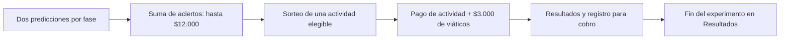

> **Actualización vigente del 30/10/2026:** las cuatro preguntas siguen el documento de secuencia del 29/10. Todas usan barras de 0% a 100%, con movimiento obligatorio. B responde primero el porcentaje de A que continúa y luego estima la respuesta de su pareja A sobre el porcentaje de B que comparte. Esa segunda predicción de B se paga contra la estimación de su pareja A, no contra decisiones reales. Las menciones posteriores a una predicción binaria describen versiones anteriores.

> **Actualización del 29/10/2026:** las estimaciones porcentuales ahora se responden con una barra de 0% a 100%, en pasos de un punto porcentual, que debe moverse antes de continuar. Se paga $6.000 si el porcentaje observado está a ±5 puntos porcentuales de la estimación, incluidos los extremos. Esta regla reemplaza los intervalos de 20 puntos. La predicción binaria de B y el sorteo por bloque se mantienen. El PDF del 27/10 y las tablas históricas siguientes no incorporan este cambio de regla.

# Auditoría y correcciones del experimento

Actualización: 27/10/2026. Base auditada el 26/10/2026: commit `031ebb66b772fb00ec3d1f222ea2374afcae4056` de https://github.com/otreeconfianza/Experimento. Las correcciones siguientes son locales; todavía no se publicaron en GitHub ni se desplegaron.

## Decisiones recibidas y aplicación

Los comentarios de dirección se interpretaron por su contenido: la referencia son los demás A y el sorteo corresponde al bloque de predicciones. El guion recibido para el caso sin decisiones B no se interpretó como autorización para cambiar ese caso.

| Tema | Regla actual aplicada | Estado |
|---|---|---|
| Predicciones de B | Dos preguntas por fase: decisión de su pareja A y porcentaje de A que continúa. Se retiraron la pregunta adicional, su HTML, sus campos del modelo, su página y su contribución a pagos. | Implementado |
| Referencia de A | La segunda predicción de A se compara con los demás A de la misma fase, excluyendo su propia decisión. La predicción de B sigue usando todos los A. | Implementado |
| Unidad de sorteo | Se sortea el bloque de predicciones de una fase y se suman sus dos preguntas. Cada acierto paga $6.000. Máximo del bloque: $12.000 para A o B, antes de viáticos. Las instrucciones lo explican. | Implementado |
| Empates modales | Por cada pregunta se sortea, con igual probabilidad, una de las respuestas más frecuentes. El mismo resultado se aplica a todos; ganan quienes eligieron esa respuesta. El sorteo queda guardado en `session.vars['normas_respuestas_pago']` para no repetirse al recalcular. | Implementado |
| Moneda | Pesos argentinos: `REAL_WORLD_CURRENCY_CODE = 'ARS'`. Se aclara la moneda en la explicación general. | Implementado |
| Final del experimento | Por decisión posterior, el experimento termina en Resultados, como antes. Se eliminaron la pantalla posterior, su clase, su entrada en la secuencia y el botón para avanzar. | Implementado |



## Detalles relevantes

- **Los demás A:** se filtran los participantes por fase y rol, y se excluye al propio A por su identificador. Una prueba con dos A que toman decisiones opuestas verifica que las referencias individuales son 0% y 100%, no el 50% del conjunto.
- **Empates:** no se sortea a una persona ni se paga a todas las categorías empatadas. Se sortea una respuesta ganadora por pregunta y se paga a todas las personas que la eligieron. Esta es la interpretación aplicada de “pago aleatorio”.
- **Datos faltantes en normas:** una respuesta ausente ya no se premia por coincidir con una moda ausente. Este ajuste evita el pago defensivo incorrecto identificado en la auditoría inicial.
- **Final en Resultados:** se conserva en esa pantalla la información del pago y el acceso a Forms. No hay botón para avanzar ni pantalla posterior. Esto no certifica la recepción de datos por Forms.

## Pendientes del protocolo

| Prioridad | Caso | Comportamiento actual / decisión pendiente |
|---|---|---|
| Alta | Ningún A continúa | No hay decisiones B observadas y la primera predicción de A paga $0 para cualquier intervalo. Se mantuvo el comportamiento; el comentario recibido fue un guion. Falta definir y explicar la regla. |
| Alta | Solo hay un A por fase | Con cuatro participantes totales no existen otros A. La segunda predicción de A tiene referencia ausente y paga $0. No se impuso un mínimo nuevo ni se inventó una excepción. Para tener al menos dos A por fase se necesitan ocho participantes totales. |
| Resuelto el 29/10 | Límites de intervalos | Se sustituyeron los intervalos por porcentajes enteros y tolerancia inclusiva de ±5 puntos porcentuales. |

## Riesgos técnicos y operativos aún abiertos

| Prioridad | Hallazgo | Acción pendiente |
|---|---|---|
| Alta | Clave secreta fija en `settings.py`. | Configurar por entorno y rotar la clave utilizada en producción. No se accedió al despliegue ni se afirma una intrusión. |
| Media | Abandonos o rechazo del consentimiento pueden detener la sesión por las esperas globales. | Definir y ensayar intervención del investigador y procedimiento de retiro. Cualquier respuesta automática requiere aprobar el criterio experimental. |
| Media | Dependencias con mínimos abiertos, sin versiones fijas reproducibles. | Fijar versiones verificadas y documentar instalación. El entorno de pruebas usa oTree 5.11.5 y Python 3.9. |
| Media | Número de cobro único dentro de cada sesión, pero potencialmente repetible entre sesiones. Forms no confirma recepción al experimento. | Conciliar sesión más código; verificar el formulario y la recepción de datos. |
| Baja | Ayuda con accesibilidad incompleta. | Agregar manejo de foco, semántica de diálogo y cierre mediante teclado. |
| Baja | Comprensión no integrada y copias históricas de pantallas. | Definir si se exige comprensión; separar archivos históricos del código activo. |

## Verificación de las correcciones

Las pruebas de reglas están en `verificar_reglas.py`. Ejecutar desde la carpeta de la app:

```sh
python3 auditoria/verificar_reglas.py
```

Resultado del 27/10/2026, antes de retirar el cierre: **11 pruebas de reglas aprobadas y 9 sesiones de bots completadas**, con 156 recorridos de participantes a través de cuatro rondas. Los logs corresponden a esa corrida; no se presentan como una ejecución posterior al último ajuste de navegación.

| Participantes por sesión | Compartir | No compartir | No continuar |
|---|---|---|---|
| 4 | OK | OK | OK |
| 8 | OK | OK | OK |
| 40 | OK | OK | OK |

Once pruebas verifican: límites de intervalos, denominador condicionado de B, ausencia de decisiones B, exclusión del propio A con decisiones opuestas, ausencia de otros A, las dos predicciones de B y su máximo de $12.000, selección exclusivamente entre respuestas modales, moda sin empate, ganador compartido y persistente al recalcular, normas ausentes sin pago y puntuación exacta.

`bots_otree.py` recorre las cuatro rondas con compartir, no compartir y no continuar. Verifica pagos de confianza y predicciones, viáticos y consistencia del pago final, códigos únicos dentro de cada sesión y presencia del número de pago en Resultados, que vuelve a ser la pantalla terminal. No se envía un formulario adicional.

Las corridas se realizan sobre una copia desechable en `/tmp/experimento_correcciones_20261027`, con el archivo de bots copiado como `experimento_final/tests.py`. No se modifica ni reinicia la base original. Los logs renovados de esta carpeta reemplazan las corridas de la versión anterior para que la evidencia corresponda al código actual.

## Alcance y límites

Se revisaron código Python, plantillas, formularios, emparejamientos, sincronización, predicciones, normas, sorteo final y configuración local. La revisión no equivale a una certificación de producción. Los bots envían respuestas al servidor y no ejecutan el JavaScript ni interactúan visualmente como una persona.

Quedan por probar navegador y móvil, juegos, portapapeles, JavaScript del cuestionario, reconexiones, abandonos reales, carga concurrente y recepción de Microsoft Forms. No se accedió al servidor, sus variables, TLS, respaldos o bases remotas; no se midieron memoria, CPU o latencia.

## Despliegue de los cambios

Se eliminaron campos del modelo. Las sesiones y exportaciones antiguas pueden conservar columnas y datos de la versión previa: quitar código no borra datos históricos. Antes de desplegar, respaldar/exportar la base actual y validar la actualización con la versión de oTree utilizada en el servidor. No se borró ni migró la base original durante este trabajo. Los cambios no se aplican retrospectivamente a sesiones existentes.

## Textos modificados: Antes / Ahora

Comparación literal con la versión base de Git (`031ebb6`). Se normalizan solamente saltos de línea y etiquetas HTML para facilitar la lectura. Los marcadores `{{ pago_final }}` y `{{ numero_pago }}` se sustituyen por sus valores al mostrar la pantalla. “No existía” identifica una incorporación, no un texto anterior.

### 1. Cantidad de predicciones de B

Archivo: `CreenciaBDecisionA.html`.

| Antes | Ahora |
|---|---|
| A continuación, se le solicitará que realice algunas predicciones sobre las decisiones de los otros jugadores. | A continuación, se le solicitará que realice dos predicciones sobre las decisiones de los otros jugadores. |

### 2. Pago del bloque de B

Archivo: `CreenciaBDecisionA.html`.

| Antes | Ahora |
|---|---|
| Si esta parte es seleccionada para el pago, usted podrá obtener una ganancia en función de la precisión de sus respuestas (se sumará lo obtenido en cada una). | Si el bloque de predicciones de esta fase es seleccionado para el pago, se sumarán las ganancias de sus dos predicciones. Cada predicción correcta paga $6.000, con un máximo de $12.000 por bloque. |

### 3. Pago del bloque de A

Archivo: `CreenciaParticipanteA.html`.

| Antes | Ahora |
|---|---|
| Si esta pregunta es seleccionada para el pago, podrá obtener una ganancia dependiendo de la precisión de su predicción: Si el valor real se encuentra dentro del intervalo que usted eligió, podrá recibir un monto de $6.000. De lo contrario, no obtendrá ganancias en esta instancia. | Si el bloque de predicciones de esta fase es seleccionado para el pago, se sumarán las ganancias de sus dos predicciones. Cada predicción correcta paga $6.000, con un máximo de $12.000 por bloque. En esta pregunta, si el valor real se encuentra dentro del intervalo elegido, obtendrá $6.000; de lo contrario, obtendrá $0. |

### 4. Referencia a los demás A

Archivo: `CreenciaPorcentajeAContina.html`.

| Antes | Ahora |
|---|---|
| Estime qué porcentaje de los demás participantes A elegirá CONTINUAR. | Estime qué porcentaje de los demás participantes A de esta fase elegirá CONTINUAR. Su propia decisión no se incluye en este porcentaje. |

### 5. Recordatorio del bloque en la segunda predicción de A

Archivo: `CreenciaPorcentajeAContina.html`.

| Antes | Ahora |
|---|---|
| No existía este párrafo. | Si el bloque de predicciones de esta fase es seleccionado para el pago, se sumarán las ganancias de las dos predicciones, hasta un máximo de $12.000. |

### 6. Recordatorio del bloque en la segunda predicción de B

Archivo: `CreenciaBPorcentajeA.html`.

| Antes | Ahora |
|---|---|
| No existía este párrafo. | Si el bloque de predicciones de esta fase es seleccionado para el pago, se sumarán las ganancias de las dos predicciones, hasta un máximo de $12.000. |

### 7. Explicación general: bloque y moneda

Archivo: `ExplicacionGeneral.html`.

| Antes | Ahora |
|---|---|
| No existía este párrafo. Se conserva el párrafo previo sobre el sorteo de una actividad. | En cada fase del juego de confianza realizará dos predicciones. Si el bloque de predicciones de una fase es seleccionado para el pago, se sumarán las ganancias de las dos preguntas de esa fase: $6.000 por acierto, hasta un máximo de $12.000. No se sortea una pregunta individual. Todos los importes se expresan en pesos argentinos. |

### 8. Regla de empate modal

Archivo: `InstruccionesNormas.html`.

| Antes | Ahora |
|---|---|
| No existía un texto que explicara el desempate. | Si dos o más respuestas empatan como las más elegidas en una pregunta, la computadora sorteará una de esas respuestas con igual probabilidad. Ese sorteo será único para la pregunta y común a todos los participantes. Recibirán $3.000 quienes hayan elegido la respuesta sorteada. |

### 9. Final del experimento en Resultados

Archivo: `Resultados.html`.

| Antes | Ahora |
|---|---|
| No existían una instrucción ni un botón para avanzar. | Se mantiene ese comportamiento. Se retiraron la instrucción y el botón agregados durante la revisión. |

### 10. Pantalla posterior retirada

La pantalla posterior a Resultados se eliminó del proyecto por decisión posterior. No queda una plantilla ni una clase activa para ese paso. El experimento vuelve a terminar en Resultados.

### 11. Configuración de moneda

Archivo: `../settings.py`.

| Antes | Ahora |
|---|---|
| REAL_WORLD_CURRENCY_CODE = 'USD' | REAL_WORLD_CURRENCY_CODE = 'ARS' |

## Resaltado temporal para la reunión

Los textos modificados y los importes afectados en Resultados aparecen en amarillo. No cambia el cálculo de pagos ni las respuestas del formulario.

El resaltado se activa mediante `{{ include_sibling 'ResaltadoRevision.html' }}` en la primera línea de `CodigoParticipante.html`. Para quitar todo el amarillo, eliminar esa única línea y recargar las páginas. Las clases `revision-cambio` quedan inactivas sin ese archivo de estilos.

El amarillo identifica contenido visible modificado o afectado; la eliminación de una pantalla y los cambios internos de Python se revisan en el diff de Git y en las secciones anteriores del informe.

## Cambio de elicitación del 29/10/2026

| Antes | Ahora |
|---|---|
| Selección de uno de cinco intervalos de 20 puntos porcentuales. | Barra de 0% a 100%, en pasos de 1 punto porcentual. El valor inicial de 50% no es una respuesta: debe cambiarse la posición para habilitar Siguiente. Tras moverla, puede volver a 50%. |
| Pago si el porcentaje real pertenecía al intervalo elegido. | Pago de $6.000 si la diferencia entre la estimación y el porcentaje real es de hasta 5 puntos porcentuales, inclusive; $0 fuera de ese rango. Una estimación de 50% paga con valores reales entre 45% y 55%, inclusive. |
| Campos de texto con códigos de intervalo. | Nueve campos enteros, entre 0 y 100, para las tres preguntas porcentuales en las tres fases. Se eliminó la conversión a intervalos del cálculo. |

### Alcance

Aplica a las dos predicciones porcentuales de A y a la predicción porcentual de B. La decisión binaria de B sigue pagándose por coincidencia exacta. Se mantienen dos predicciones por rol y fase, el máximo de $12.000 por bloque y los $3.000 de viáticos. Para A se excluye su propia decisión en la segunda predicción; B toma como referencia todos los A. La predicción sobre B usa las decisiones B efectivamente observadas. Si no hay referencia observable se mantiene pago cero, pendiente de definición del protocolo.

Los nuevos textos visibles están marcados con `revision-cambio`. La barra se comparte mediante `BarraCreencia.html`. La regla de pago está escrita directamente en cada una de las cuatro plantillas de predicción, con una estructura uniforme: condición de acierto y pago por bloque. Los textos explicativos anteriores de este informe se conservan como historial; esta sección determina la regla vigente.

La prueba de JavaScript `verificar_barra.js` ejecuta el controlador real contra un DOM mínimo y verifica bloqueo inicial, falta de movimiento, 0%, 100% y retorno a 50%. No equivale a una prueba visual en navegador. `verificar_reglas.py` comprueba los límites inclusivos, valores justo fuera del margen, porcentajes reales fraccionarios y aceptación de 0% sin permitir una respuesta ausente. La validación del formulario en oTree rechaza valores fuera de 0 a 100.

Cambió el tipo de campos del modelo: respaldar y validar la actualización de la base antes de desplegar; no se modificó la base original ni se convierten retrospectivamente respuestas históricas de intervalos a porcentajes.

Verificación del 29/10 completada: **12 pruebas de reglas aprobadas**, prueba del controlador JavaScript aprobada y **tres sesiones de bots con ocho participantes** completadas (compartir, no compartir y no continuar). Evidencia: `bot_8_porcentajes_20261029.log`. No se repitió una prueba con 40 participantes ni se realizó revisión visual en navegador para esta versión.

## Alineación de las preguntas con el documento del 29/10

| Participante / pregunta | Pregunta vigente | Referencia de pago |
|---|---|---|
| A - 1 | Porcentaje de B de esta sesión que elegirá COMPARTIR. | Porcentaje observado de B que comparte, entre quienes efectivamente decidieron. |
| A - 2 | Porcentaje de los demás A de esta sesión que elegirá CONTINUAR. | Porcentaje de A que continúa en la misma fase, excluyendo al propio A. |
| B - 1 | Porcentaje de A de esta sesión que elegirá CONTINUAR. | Porcentaje observado de todos los A de la fase. |
| B - 2 | Qué porcentaje estima su pareja A que elegirá COMPARTIR entre los B. | Estimación porcentual dada por su pareja A en su primera pregunta de la misma fase. |

Se adoptan las dos preguntas desarrolladas para B en el documento; no se adopta el encabezado contradictorio que anuncia una sola pregunta. Se conservan las barras, su diseño, movimiento obligatorio y las respuestas enteras de 0 a 100. Las líneas con espacios en blanco del documento se sustituyen por la barra. No se muestran nombres técnicos de las tareas. Los textos de pago están escritos directamente en las cuatro pantallas y resaltados con `revision-cambio`.

Cada pregunta paga $6.000 cuando la diferencia respecto de su referencia es de hasta cinco puntos porcentuales inclusive; en otro caso, $0. Se suman ambas si se selecciona el bloque. Para B se explica qué referencia corresponde a cada pregunta, según el documento.

La pantalla existente `CreenciaBPorcentajeA.html` pasa a ser Predicción 1. La pantalla existente `CreenciaBDecisionA.html` pasa a ser Predicción 2 y usa la barra. Por compatibilidad de ubicación se conserva ese nombre de archivo, pero sus campos se reemplazan por `creencia_b_estimacion_a_f1`, `f2` y `f3`: ya no almacenan una decisión binaria. Se actualizan secuencia y cálculo de pagos. La base original no se modificó; los campos nuevos requieren validar la actualización del modelo antes de desplegar.

No se agregó una espera colectiva antes de las decisiones ni se redefinieron los casos sin porcentaje observable. No se modificaron el juego del dictador, las normas o el cuestionario. El PDF anterior no incorpora esta actualización.

Verificación del 30/10: **13 pruebas de reglas aprobadas**, controlador de barra aprobado y **tres sesiones de ocho participantes completadas** con compartir, no compartir y no continuar. Log: `bot_8_documento_20261030.log`. La prueba de la segunda creencia de B comprueba ambos límites (65 y 75 frente a una estimación de A de 70), valores fuera del margen y separación respecto de decisiones reales.

## Reescritura y nombre de la segunda predicción de B

Se reescribieron las cuatro plantillas a partir del texto del documento, conservando barras, diseño, movimiento obligatorio y amarillo. La segunda predicción de B se sirve ahora mediante `CreenciaBEstimacionA.html` y la clase `CreenciaBEstimacionA`; se retiró el antiguo archivo de nombre binario y se actualizaron secuencia y pruebas. El pago continúa comparando la respuesta de B con la estimación de su pareja A dentro de ±5 puntos porcentuales. Las referencias anteriores al nombre de archivo previo son históricas.
